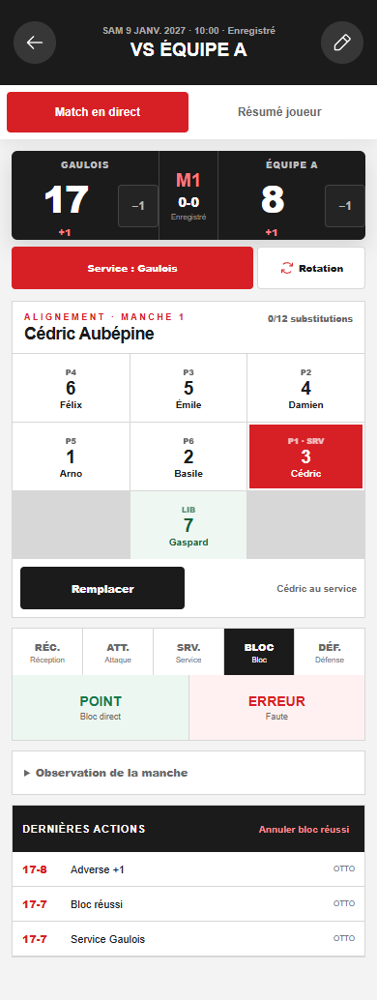
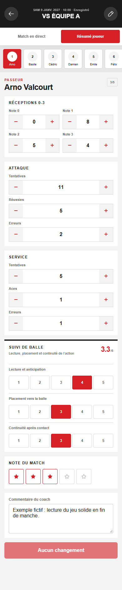
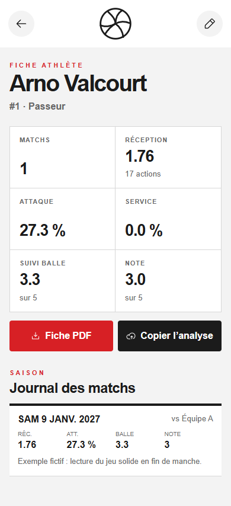

# Suivi Gaulois

A phone app for taking volleyball match statistics from the bench, one action at a time, without a network. I coach the volleyball teams at Collège de Rosemont and I wanted the numbers a clipboard gives, without the clipboard and without the evening spent typing them in.

The code is private, and so is the player data. This page is the product's public record: what it does, what is not there yet, and how it is built. The screenshots come from a local instance with a fictional roster.

  
  &nbsp;&nbsp;
  
  &nbsp;&nbsp;
  

Live entry, post-match summary, player page. Fictional team.

## During the match

One coach holds the phone. Each action takes one to three taps: the player, if it changed; the category (reception, attack, serve, block, defense), if it changed; then the result. Reception is graded 0 to 3. The score is a separate tap: a statistic never adds a point, because the two are not the same thing and mixing them is how a sheet ends up wrong. Rotation is manual. A serve or a reception moves the serving side. The last statistic can be undone with one tap, and a minus one corrects the score.

The app knows the rules it needs: sets to 25, 25 and 15 with two points of margin, six positions and a libero, twelve or six substitutions per set depending on the rule chosen before the set. It counts substitutions without blocking the coach: the referee is the one who blocks.

Every action is written on the phone first, then sent. Events sync after each action and every 2.5 seconds, the whole document every 4 seconds. If the gym has no signal, the match is entered the same way and uploaded later; the event queue is idempotent, so a reconnection never duplicates an action.

## After the match

- A match screen with the set scores and the sync state.
- A summary per player where the coach corrects the counters, adds three ball tracking notes, a rating out of 5 and a comment.
- A player page with season averages and the match by match log.
- A one page PDF per player, generated in the browser, nine matches at most.
- A dashboard with the next match, four team indicators and the four best ratings.
- A read-only MCP server, in its own repository, that lets an assistant read the season's statistics and answer questions about them: [suivi-gaulois-mcp](https://github.com/OTTOPro/suivi-gaulois-mcp).

Computed on the device, from the counters: reception average, attack efficiency (kills minus errors over attempts), serve efficiency (aces minus errors over attempts), ball tracking average. Nothing is computed on the server.

## What is not there

- No team report after a match: the summaries are per player.
- No trend: averages and a log, no curves.
- Blocks and digs are entered and computed, but no screen shows them yet.
- Matches come from the seed. Creating a match or changing its date, opponent or venue in the app is not done yet.
- Counters are per match, not per set.
- Two coach profiles, chosen on the device, with nothing stopping either from entering any match.

## How it is built

React 19 and TypeScript, a hand written service worker and IndexedDB for the offline queue, a Cloudflare Worker with no framework in front of D1. The whole state is one JSON document with a revision number; match events are a separate append only log, deduplicated by device and sequence. Sign-in is a shared password with a rate limit and a 30 day HMAC cookie: this is a tool for two coaches, not a public service. Vitest for the rules and the statistics, GitHub Actions on every push.

## About the data

Players are students. This page contains no real name, number, result, opponent or venue; the screenshots were taken from an invented roster and schedule. The deployed instance is private to the coaching staff. The "Copy analysis" text identifies a player by jersey number, but a comment can still name someone: read it before you paste it anywhere.
